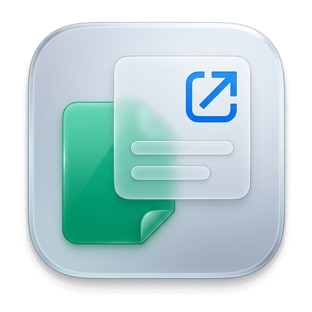
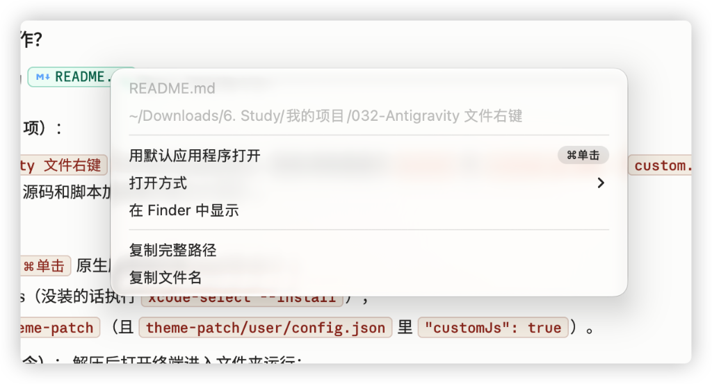

<div align="center">



<h1>Antigravity File Opener</h1>

<p>
  Native macOS <strong>Liquid Glass</strong> context menu &amp; <code>⌘ + Click</code> external file opener for <strong>Antigravity 2.0</strong> chat file pills<br />
  Zero client binary patching · No Accessibility permissions required · Compatible with <code>theme-patch</code> &amp; <code>context-viewer</code>
</p>

<p>
  <a href="README.md">简体中文</a> &nbsp;|&nbsp; <strong>English</strong>
</p>

<p>
  
  
  
  
  
</p>

<p>
  
  
  
  
  
  
</p>

<br />



</div>

---

## One-Click AI Install Prompt (Copy & Paste to Your Agent)

Click the **Copy** button in the top-right corner of the code block below and paste it into **Antigravity / Claude Code / Codex** to automatically check prerequisites, clone, build, install, and verify:

```text
Please install and enable https://github.com/JaffryGao/antigravity-file-opener (native macOS context menu and Cmd+Click external file opening for Antigravity chat file pills):

1. Check local prerequisites: confirm macOS 13+, verify `swiftc` (Xcode Command Line Tools) and `node` are available, and check that `~/.gemini/antigravity/theme-patch/user/custom.js` exists with `"customJs": true` in `theme-patch/user/config.json`. If anything is missing, tell me how to install/enable it first.
2. Clone the repository to `~/antigravity-file-opener` (or pull latest if it already exists):
   git clone https://github.com/JaffryGao/antigravity-file-opener.git ~/antigravity-file-opener
3. Build, install to `/Applications/AntigravityFileOpener.app`, register the silent LaunchAgent, and sync the frontend snippet:
   cd ~/antigravity-file-opener && chmod +x build.sh install-service.sh uninstall.sh && ./install-service.sh
4. Verify the installation:
   - Confirm all 17 unit tests and code signing passed;
   - Run `curl -sS http://127.0.0.1:59321/health` and confirm `{"ok":true,"service":"AntigravityFileOpener"}`;
   - Confirm the `launchctl` job is `running` and `/tmp/antigravity-file-opener.err` is empty;
   - Confirm `~/.gemini/antigravity/theme-patch/user/custom.js` passes `node --check` and hot-reloaded in `theme-patch`.
5. Summarize how to test (`⌘ + Click` and `Right-Click` on any chat file pill) and how to uninstall (`~/antigravity-file-opener/uninstall.sh`).
```

### Manual Quick Install (Terminal)

```zsh
git clone https://github.com/JaffryGao/antigravity-file-opener.git ~/antigravity-file-opener
cd ~/antigravity-file-opener
chmod +x build.sh install-service.sh uninstall.sh
./install-service.sh
```

> **No Antigravity restart** and **no Accessibility permission prompts** required. Changes hot-reload in ~1–2 seconds and persist automatically across app restarts and system reboots.

---

## Key Features

| Action | Behavior |
| :--- | :--- |
| **`⌘ + Left-Click` on a file/folder pill** | Prevents in-app preview and immediately opens the target in its macOS default app via `NSWorkspace` (opens folders in Finder) |
| **`Right-Click` on a file/folder pill** | Replaces the single-"Copy" popup with a genuine **AppKit native `NSMenu`** featuring macOS Liquid Glass translucency |
| **Native Context Menu Items** | File icon, filename & shortened directory header; **Open with Default App** (with native `⌘单击` badge on macOS 14+), **Open With ›** submenu (lists all registered macOS apps with real app icons, default app pinned first), **Reveal in Finder**, **Copy Full Path**, and **Copy Filename** |
| **`⌥ + Right-Click` on a file pill** | Escape hatch to access Antigravity's original context menu whenever needed |
| **Hover over a file pill** | Mirrors `data-uri` to the standard HTML `title` attribute so hovering previews the full decoded local path |
| **Web links, plugin pills & inputs** | Strict protocol allowlist ensures normal links, sidecar pills, and text editors pass through untouched |

---

## Architecture

A decoupled two-stage design combining **DOM capture interception** with a **silent native Swift loopback executor**:

```text
Antigravity Renderer (~/.gemini/antigravity/theme-patch/user/custom.js)
  ├─ ⌘ + Left-Click .inline-pill[data-uri] ──▶ POST http://127.0.0.1:59321/open
  └─ Right-Click .inline-pill[data-uri]    ──▶ POST http://127.0.0.1:59321/menu
                                                      │
                                                      ▼
Background Native Service (/Applications/AntigravityFileOpener.app via LaunchAgent)
  ├─ LocalActionServer.swift   127.0.0.1:59321 only (Origin allowlist + 0600 random local token)
  ├─ FileLinkParser.swift      Decodes file:// URIs & local paths, strips #L / :line suffixes, checks existence
  └─ ContextMenuPresenter.swift Pops up genuine AppKit NSMenu + "Open With ›" submenu via NSWorkspace
```

### Why not `CGEventTap` + macOS Accessibility?
1. Antigravity renders chat file pills as `<span class="inline-pill" data-uri="...">`, and Chromium does not expose custom `data-*` attributes to the macOS Accessibility Tree.
2. On modern macOS releases, global mouse `CGEventTap` hooks inside `LaunchAgent` daemons can be silently filtered by Input Monitoring policies or conflict with third-party mouse utilities (e.g., Mac Mouse Fix).

Using DOM capture + a local Swift loopback service achieves **zero permission friction, zero latency, and 100% hit accuracy** without touching `Antigravity.app`.

---

## Project Structure

```text
antigravity-file-opener/
├── README.md                        # Chinese documentation
├── README.en.md                     # English documentation
├── assets/
│   ├── logo.png                     # Project logo
│   └── preview.png                  # Native Liquid Glass menu screenshot
├── build.sh                         # Runs unit tests, compiles & signs the .app (--install copies to /Applications)
├── install-service.sh               # Builds, installs, registers LaunchAgent & syncs frontend snippet
├── uninstall.sh                     # Cleanly removes LaunchAgent, .app, token & custom.js snippet
├── sync-custom-js.mjs               # Safely injects/removes the frontend block in theme-patch/user/custom.js
├── frontend/
│   └── file-opener-snippet.js       # Capture-phase DOM listener injected via theme-patch
├── Sources/
│   ├── main.swift                   # Single-instance accessory entrypoint (no Dock icon)
│   ├── AppDelegate.swift            # Lifecycle, 32-byte random token management & silent mode (--silent)
│   ├── LocalActionServer.swift      # Loopback-only POSIX HTTP server (/health /open /reveal /menu)
│   ├── ContextMenuPresenter.swift   # Native AppKit NSMenu, macOS 14+ badge & Open With submenu
│   └── FileLinkParser.swift         # Pure-logic path & file:// URI resolver
└── Tests/
    └── FileLinkParserTests.swift    # 17 unit tests covering Unicode, spaces, anchors & protocol filtering
```

---

## Requirements & Security

- **Requirements**: macOS 13+ (native badge requires macOS 14+), Xcode Command Line Tools (`xcode-select --install`), Node.js, and `theme-patch` enabled with `"customJs": true` in `~/.gemini/antigravity/theme-patch/user/config.json`.
- **Untouched Host App**: Never unpacks or modifies `Antigravity.app` / `app.asar`; survives official Antigravity updates intact.
- **Loopback-Only Binding**: Strictly binds to `INADDR_LOOPBACK (127.0.0.1:59321)` — unreachable from LAN or internet.
- **Per-Machine Random Token + Origin Check**: Generates a 32-byte random secret at `~/.config/antigravity-file-opener/token` (`0600`), rejecting missing/invalid tokens (`401`) and external web origins (`403`).
- **No Shell Execution**: Validates target existence on disk and delegates directly to Apple's `NSWorkspace` APIs — never invokes a shell.

---

## Troubleshooting & Uninstall

```zsh
# Check LaunchAgent status
launchctl print "gui/$(id -u)/com.antigravity.file-opener" | grep -E "state =|pid ="

# Verify local service health (expects {"ok":true,"service":"AntigravityFileOpener"})
curl -sS http://127.0.0.1:59321/health

# Inspect logs
cat /tmp/antigravity-file-opener.log
cat /tmp/antigravity-file-opener.err

# Completely uninstall
~/antigravity-file-opener/uninstall.sh
```
