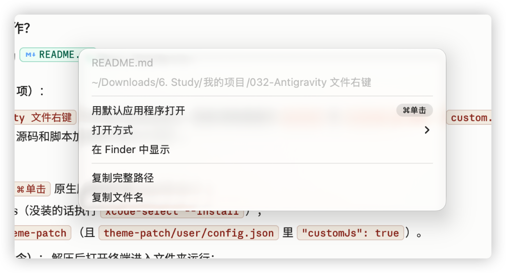

# Antigravity File Opener

为 macOS 版 **Antigravity 2.0** 对话界面的文件/文件夹胶囊提供真正的系统级快捷打开与原生右键菜单体验——**不修改 `Antigravity.app` 本体**、**无需辅助功能权限**、与 `antigravity-context-viewer` 及 `theme-patch` 完全兼容。

<p align="center">
  
</p>

---

## 一键安装 Prompt（点右上角复制，发给 AI 助手自动装）

点击下面代码块右上角的 **复制按钮**，直接粘贴给 Antigravity / Claude Code / Codex，即可全自动完成克隆、编译、安装与验证：

```text
请帮我安装并启用 https://github.com/JaffryGao/antigravity-file-opener （Antigravity 文件胶囊原生右键菜单与 ⌘+单击 默认应用打开增强）：

1. 检查本机前置环境：确认系统为 macOS 13+，检查 `swiftc`（Xcode Command Line Tools）、`node` 是否可用，并确认 `~/.gemini/antigravity/theme-patch/user/custom.js` 存在且 `theme-patch/user/config.json` 中 `"customJs": true`。若有缺失先告诉我如何补齐再继续。
2. 将仓库克隆到 `~/antigravity-file-opener`（若目录已存在则先拉取最新代码）：
   git clone https://github.com/JaffryGao/antigravity-file-opener.git ~/antigravity-file-opener
3. 进入目录执行一键构建、安装与自启配置：
   cd ~/antigravity-file-opener && chmod +x build.sh install-service.sh uninstall.sh && ./install-service.sh
4. 执行安装后验证：
   - 确认 17 项单元测试与本地签名通过；
   - 执行 `curl -sS http://127.0.0.1:59321/health` 确认返回 `{"ok":true,"service":"AntigravityFileOpener"}`；
   - 确认 `launchctl` 服务状态为 `running` 且 `/tmp/antigravity-file-opener.err` 无报错；
   - 确认 `~/.gemini/antigravity/theme-patch/user/custom.js` 语法检查通过且 `theme-patch` 已热重载。
5. 完成后告诉我测试方法（直接对任意文件胶囊尝试 `⌘ + 左键单击` 和 `右键单击`）以及后续卸载命令（`~/antigravity-file-opener/uninstall.sh`）。
```

### 手动一键安装（终端版）

如果你习惯自己敲命令，直接执行：

```zsh
git clone https://github.com/JaffryGao/antigravity-file-opener.git ~/antigravity-file-opener
cd ~/antigravity-file-opener
chmod +x build.sh install-service.sh uninstall.sh
./install-service.sh
```

安装完成后**无需重启 Antigravity**、**无需配置任何辅助功能权限**，约 1~2 秒自动热生效；重启 Antigravity 或重启电脑后均会自动静默可用。

---

## 核心功能

| 操作 | 效果 |
| :--- | :--- |
| **`⌘ + 左键单击` 文件/目录胶囊** | 拦截 Antigravity 内部打开，直接调用 `NSWorkspace` 用 macOS 默认应用程序打开（目录自动在 Finder 中打开） |
| **`右键单击` 文件/目录胶囊** | 拦截原有仅含「复制」的浮窗，在鼠标处弹出真正的 **macOS 系统原生 `NSMenu`**（与 Finder 同款 Liquid Glass 液态玻璃质感） |
| **原生右键菜单项** | 顶部显示文件真实图标、文件名与精简目录；支持 **用默认应用程序打开**（带原生 `⌘单击` 徽标）、**打开方式 ›**（自动列出本机所有可打开该文件的应用及图标，默认应用置顶）、**在 Finder 中显示**、**复制完整路径**、**复制文件名** |
| **`⌥ + 右键单击` 文件胶囊** | 临时逃生通道，放行 Antigravity 原生右键菜单 |
| **鼠标悬停文件胶囊** | 自动同步完整路径到标准 `title` 属性，悬停即可预览绝对路径 |
| **网页链接 / 插件胶囊 / 输入框 / 普通文本** | 严格白名单隔离，全部原样放行，不误拦、不干扰正常编辑 |

---

## 工作原理与架构

采用 **「前端 DOM 捕获拦截 + 后台原生 Swift 回环服务」** 的两段式解耦架构：

```text
Antigravity 渲染层 (~/.gemini/antigravity/theme-patch/user/custom.js)
  ├─ ⌘ + 左键单击 .inline-pill[data-uri] ──▶ POST http://127.0.0.1:59321/open
  └─ 右键单击 .inline-pill[data-uri]     ──▶ POST http://127.0.0.1:59321/menu
                                                      │
                                                      ▼
后台原生服务 (/Applications/AntigravityFileOpener.app，由 LaunchAgent 静默常驻)
  ├─ LocalActionServer.swift   仅监听 127.0.0.1:59321（Origin 白名单 + 0600 本地随机 Token 鉴权）
  ├─ FileLinkParser.swift      解析/解码 file:// URI 与绝对路径、剥离 #L / :行号、校验文件存在
  └─ ContextMenuPresenter.swift 弹出真·AppKit NSMenu 与「打开方式 ›」，调用 NSWorkspace 执行动作
```

### 为什么不走 `CGEventTap` + 辅助功能？
1. Antigravity 文件胶囊是自定义 `<span class="inline-pill" data-uri="...">`，Chromium 不会将 `data-uri` 暴露给 macOS Accessibility Tree；
2. macOS 新版下，`LaunchAgent` 后台进程的全局鼠标钩子容易受系统输入监控策略及第三方鼠标工具（如 Mac Mouse Fix）影响导致丢事件。

改为「前端 DOM 捕获 + 本地回环原生执行器」后，**零权限弹窗、零延迟、100% 精准命中**，且依然**完全不修改 `Antigravity.app` 本体**。

---

## 目录结构

```text
antigravity-file-opener/
├── README.md
├── assets/
│   └── preview.png                  # 原生液态玻璃右键菜单效果图
├── build.sh                         # 运行单元测试、编译、自动签名（支持 --install 安装到 /Applications）
├── install-service.sh               # 一键编译安装、配置 LaunchAgent 开机自启并同步前端模块
├── uninstall.sh                     # 一键彻底卸载（清理 LaunchAgent、App、Token 与 custom.js 追加块）
├── sync-custom-js.mjs               # 将前端交互模块安全同步至 theme-patch/user/custom.js
├── frontend/
│   └── file-opener-snippet.js       # 注入到 theme-patch/user/custom.js 的前端事件拦截模块
├── Sources/
│   ├── main.swift                   # 单实例防多开入口（Accessory 无 Dock 模式）
│   ├── AppDelegate.swift            # 生命周期管理、随机 Token 生成与服务启动（--silent 静默无图标）
│   ├── LocalActionServer.swift      # 仅绑 127.0.0.1 的 POSIX HTTP 服务（/health /open /reveal /menu）
│   ├── ContextMenuPresenter.swift   # AppKit 原生 NSMenu、原生 ⌘单击 徽标与「打开方式 ›」子菜单
│   └── FileLinkParser.swift         # 路径与 file:// URI 解析器（支持中文/空格/括号/行号剥离）
└── Tests/
    └── FileLinkParserTests.swift    # 17 项核心解析与协议白名单单元测试
```

---

## 环境要求与安全边界

### 环境要求
- **macOS 13+**（原生 `⌘单击` 胶囊徽标需 **macOS 14+**）
- Xcode Command Line Tools（未安装可运行 `xcode-select --install`）
- Node.js（支持 Homebrew / nvm / volta 等常见路径自动发现）
- 已安装并启用 `theme-patch`（且 `~/.gemini/antigravity/theme-patch/user/config.json` 中 `"customJs": true`）

### 安全设计
- **不改动 `Antigravity.app` 本体**：不拆包 `app.asar`，官方更新不会覆盖。
- **仅本机回环监听**：只绑定 `INADDR_LOOPBACK (127.0.0.1:59321)`，不暴露局域网与外网。
- **独立随机 Token + Origin 白名单**：首次启动生成 32 字节随机密钥保存于 `~/.config/antigravity-file-opener/token`（`0600` 仅当前用户可读）；拒绝无 Token（`401`）及公网来源请求（`403`）。
- **零 Shell 执行**：仅校验目标文件/目录真实存在后调用 `NSWorkspace` 原生 API，绝不执行外部 shell 命令。

---

## 日常运维、排障与卸载

### 重启 Antigravity 或重启电脑后
无需任何操作，直接打开 Antigravity 即可使用。后台服务通过 `~/Library/LaunchAgents/com.antigravity.file-opener.plist` 开机静默自启，前端模块由 `theme-patch` 自动热注入。

### 排障检查
```zsh
# 1. 检查后台服务是否运行
launchctl print "gui/$(id -u)/com.antigravity.file-opener" | grep -E "state =|pid ="

# 2. 检查本地接口健康状态（正常返回 {"ok":true,"service":"AntigravityFileOpener"}）
curl -sS http://127.0.0.1:59321/health

# 3. 查看运行与错误日志
cat /tmp/antigravity-file-opener.log
cat /tmp/antigravity-file-opener.err

# 4. 确认 theme-patch 已热重载 custom.js
tail -n 10 /tmp/antigravity-font-daemon.log
```

### 一键彻底卸载
```zsh
~/antigravity-file-opener/uninstall.sh
```
会完整清理后台 `LaunchAgent`、`/Applications/AntigravityFileOpener.app`、本地 Token 目录以及 `theme-patch/user/custom.js` 中的附加块。
