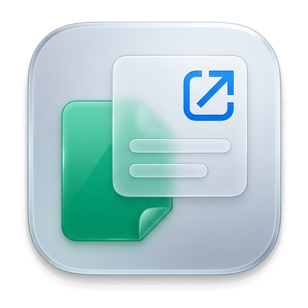

<div align="center">



<h1>Antigravity File Opener</h1>

<p>
  为 macOS 版 <strong>Antigravity 2.0</strong> 对话区文件胶囊提供真正的系统原生 <strong>Liquid Glass</strong> 右键菜单与 <code>⌘ + 单击</code> 外部默认应用打开增强<br />
  不修改客户端本体 · 无需辅助功能权限 · 兼容 <code>theme-patch</code> 与 <code>context-viewer</code>
</p>

<p>
  <strong>简体中文</strong> &nbsp;|&nbsp; <a href="README.en.md">English</a>
</p>

<p>
  
  
  
  
  
</p>

<p>
  
  
  
  
  
  
</p>

<br />


</div>

---

## 一键安装 Prompt（点右上角复制，发给 AI 助手自动装）

点击下面代码块右上角的 **复制按钮**，直接粘贴给 **Antigravity / Claude Code / Codex**，即可全自动完成环境检查、克隆、编译、安装与验证：

```text
请帮我安装并启用 https://github.com/JaffryGao/antigravity-file-opener （Antigravity 文件胶囊原生右键菜单与 ⌘+单击 默认应用打开增强）：

1. 检查本机前置环境：确认系统为 macOS 13+，检查 `swiftc`（Xcode Command Line Tools）、`node` 是否可用，并确认 `~/.gemini/antigravity/theme-patch/user/custom.js` 存在且 `theme-patch/user/config.json` 中 `"customJs": true`。若有缺失先告诉我如何补齐再继续。
2. 将仓库克隆到 `~/antigravity-file-opener`（若目录已存在则先拉取最新代码）：
   git clone https://github.com/JaffryGao/antigravity-file-opener.git ~/antigravity-file-opener
3. 进入目录执行一键构建、安装与自启配置：
   cd ~/antigravity-file-opener && chmod +x build.sh install-service.sh uninstall.sh && ./install-service.sh
4. 执行安装后验证：
   - 确认 17 项单元测试与本地签名通过；
   - 执行 `curl -sS http://127.0.0.1:59321/health` 确认返回 `{"ok":true,"service":"AntigravityFileOpener"}`；
   - 确认 `launchctl` 服务状态为 `running` 且 `/tmp/antigravity-file-opener.err` 无报错；
   - 确认 `~/.gemini/antigravity/theme-patch/user/custom.js` 语法检查通过且 `theme-patch` 已热重载。
5. 完成后告诉我测试方法（直接对任意文件胶囊尝试 `⌘ + 左键单击` 和 `右键单击`）以及后续卸载命令（`~/antigravity-file-opener/uninstall.sh`）。
```

### 手动一键安装（终端版）

```zsh
git clone https://github.com/JaffryGao/antigravity-file-opener.git ~/antigravity-file-opener
cd ~/antigravity-file-opener
chmod +x build.sh install-service.sh uninstall.sh
./install-service.sh
```

> 安装完成后**无需重启 Antigravity**、**无需开启任何辅助功能权限**，约 1~2 秒自动热生效；后续重启 Antigravity 或重启电脑均会自动静默可用。

---

## 核心功能

| 交互操作 | 实际效果 |
| :--- | :--- |
| **`⌘ + 左键单击` 文件/目录胶囊** | 拦截 Antigravity 内部打开，直接调用 `NSWorkspace` 用 macOS 默认应用程序打开（目录自动在 Finder 中打开） |
| **`右键单击` 文件/目录胶囊** | 拦截原有仅含「复制」的小浮窗，在鼠标位置弹出真正的 **macOS 系统原生 `NSMenu`**（与 Finder 同款 Liquid Glass 液态玻璃质感） |
| **原生右键菜单内容** | 文件真实图标 + 文件名 + 精简目录；**用默认应用程序打开**（macOS 14+ 原生 `⌘单击` 徽标）、**打开方式 ›**（自动列出本机全部可打开该文件的应用与真实图标，默认应用置顶）、**在 Finder 中显示**、**复制完整路径**、**复制文件名** |
| **`⌥ + 右键单击` 文件胶囊** | 临时逃生通道，放行 Antigravity 原生右键菜单 |
| **悬停文件胶囊** | 自动同步 `data-uri` 到标准 `title` 属性，鼠标悬停即可预览完整绝对路径 |
| **其他元素（网页链接 / 插件胶囊 / 输入框）** | 严格协议白名单隔离，全部原样放行，绝不误拦 |

---

## 工作原理与架构

采用 **「前端 DOM 捕获拦截 + 后台原生 Swift 回环服务」** 两段式解耦架构：

```text
Antigravity 渲染层 (~/.gemini/antigravity/theme-patch/user/custom.js)
  ├─ ⌘ + 左键单击 .inline-pill[data-uri] ──▶ POST http://127.0.0.1:59321/open
  └─ 右键单击 .inline-pill[data-uri]     ──▶ POST http://127.0.0.1:59321/menu
                                                      │
                                                      ▼
后台原生服务 (/Applications/AntigravityFileOpener.app，由 LaunchAgent 静默常驻)
  ├─ LocalActionServer.swift   仅监听 127.0.0.1:59321（Origin 白名单 + 0600 本地随机 Token 鉴权）
  ├─ FileLinkParser.swift      解析/解码 file:// URI 与绝对路径、剥离 #L / :行号、校验文件存在
  └─ ContextMenuPresenter.swift 弹出真·AppKit NSMenu 与「打开方式 ›」，调用 NSWorkspace 执行动作
```

### 为什么放弃纯 `CGEventTap` + 辅助功能方案？
1. Antigravity 文件胶囊渲染为 `<span class="inline-pill" data-uri="...">`，Chromium 不会把 `data-uri` 暴露给 macOS Accessibility Tree；
2. macOS 新版系统下，`LaunchAgent` 后台进程的全局鼠标事件钩子易受输入监控策略及第三方鼠标工具（如 Mac Mouse Fix）影响。

切换为「前端捕获 + 本地回环原生执行器」后，实现 **零权限弹窗、零延迟、100% 精准命中**，且依然**完全不修改 `Antigravity.app` 本体**。

---

## 目录结构

```text
antigravity-file-opener/
├── README.md                        # 中文文档
├── README.en.md                     # English documentation
├── assets/
│   ├── logo.png                     # 项目 Logo
│   └── preview.png                  # 原生液态玻璃右键菜单实机预览
├── build.sh                         # 跑单元测试、编译、自动签名（支持 --install）
├── install-service.sh               # 一键编译安装、配置 LaunchAgent 开机自启并同步前端
├── uninstall.sh                     # 一键彻底卸载（清理服务、App、Token 与 custom.js 追加段）
├── sync-custom-js.mjs               # 将前端交互模块安全同步至 theme-patch/user/custom.js
├── frontend/
│   └── file-opener-snippet.js       # 注入到 theme-patch/user/custom.js 的事件拦截脚本
├── Sources/
│   ├── main.swift                   # 单实例防多开入口（Accessory 无 Dock 模式）
│   ├── AppDelegate.swift            # 生命周期管理、随机 Token 生成与服务启动（--silent 静默无图标）
│   ├── LocalActionServer.swift      # 仅绑 127.0.0.1 的 POSIX HTTP 服务（/health /open /reveal /menu）
│   ├── ContextMenuPresenter.swift   # AppKit 原生 NSMenu、原生 ⌘单击 徽标与「打开方式 ›」子菜单
│   └── FileLinkParser.swift         # 路径与 file:// URI 解析器（中文/空格/括号/行号剥离）
└── Tests/
    └── FileLinkParserTests.swift    # 17 项路径解析与协议白名单单元测试
```

---

## 环境要求与安全设计

- **环境要求**：macOS 13+（`⌘单击` 原生徽标需 macOS 14+）、Xcode Command Line Tools（`xcode-select --install`）、Node.js、已启用 `theme-patch` 且 `user/config.json` 中 `"customJs": true`。
- **不改客户端本体**：不拆包 `app.asar`，Antigravity 自动更新不会破坏本工具。
- **仅本机回环监听**：只绑定 `INADDR_LOOPBACK (127.0.0.1:59321)`，外网与局域网不可访问。
- **独立随机 Token + Origin 白名单**：首次启动生成 32 字节随机密钥写入 `~/.config/antigravity-file-opener/token`（权限 `0600`），拒绝无 Token（`401`）与公网来源请求（`403`）。
- **零 Shell 执行**：仅校验目标文件/目录存在后调用原生 `NSWorkspace` API，不执行任何外部 shell 命令。

---

## 排障检查与一键卸载

```zsh
# 检查后台服务运行状态
launchctl print "gui/$(id -u)/com.antigravity.file-opener" | grep -E "state =|pid ="

# 检查本地接口健康状态（正常返回 {"ok":true,"service":"AntigravityFileOpener"}）
curl -sS http://127.0.0.1:59321/health

# 查看运行与错误日志
cat /tmp/antigravity-file-opener.log
cat /tmp/antigravity-file-opener.err

# 一键彻底卸载
~/antigravity-file-opener/uninstall.sh
```
